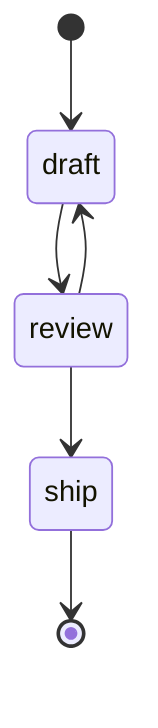

# Agenttsm

Agenttsm is a small, typed state machine runtime for AI agent workflows. You declare states and
the transitions between them. The runtime saves a snapshot after every step, and handles retries,
timeouts, budgets, and pauses for humans or webhooks. A paused run can be resumed later, in another
request or another process, without re-running the step that paused it.

```sh
pnpm add @nuvraxis-org/agenttsm
```

Requires Node.js 26 or any runtime with `fetch`, `AbortSignal.timeout`, `structuredClone` and
`crypto.randomUUID`. ESM only.

## Example

```ts
import { defineMachine } from "@nuvraxis-org/agenttsm";
const machine = defineMachine({
  initial: "draft",
  llm,
  guards: { maxSteps: 20, budgetUsd: 0.5 },
  states: {
    draft: {
      to: ["review"],
      maxRetries: 2,
      run: async (ctx: { topic: string; draft: string }, step) => {
        ctx.draft = (await step.llm.complete({ prompt: `Write about ${ctx.topic}` })).text;
        return "review";
      },
    },
    review: { to: ["draft", "ship"], run: (ctx, step) => step.route(["draft", "ship"], ctx.draft) },
    ship: { run: () => ({ done: true }) },
  },
});
const run = await machine.start({ topic: "state machines", draft: "" });
```

`llm` is anything with `complete({ prompt, system?, signal? })` returning
`{ text, tokens?, costUsd? }`; [`examples/shared`](examples/shared/src/index.ts) adapts the
Anthropic SDK.

`ctx`, the state names and the tool types are all inferred. A typo in `initial`, `to` or a returned
target is a compile error, and `defineMachine()` rejects unknown targets at runtime too.

## Concepts

| Concept    | Shape                                                                                                                                                               |
| ---------- | ------------------------------------------------------------------------------------------------------------------------------------------------------------------- |
| State      | `{ run(ctx, step) => Transition, to?, final?, maxRetries?, timeoutMs? }`                                                                                            |
| Transition | `"name"` · `{ to }` · `{ to, wait }` · `{ done: true }`                                                                                                             |
| Snapshot   | `{ runId, version, state, status, ctx, step, attempt, waiting?, reason?, usage, createdAt, updatedAt }`, where `status` is `running`, `waiting`, `done` or `failed` |
| Store      | `save(snapshot, events)`, `load(runId)`, `list(filter?)`, `trace(runId)`; `MemoryStore` is the default                                                              |
| Guards     | `maxSteps`, `maxTokens`, `budgetUsd`, `deadlineMs`, checked before every step                                                                                       |
| Machine    | `start`, `resume`, `poll`, `get`, `trace`, `on`, `toMermaid`, `http`, `test`                                                                                        |

The `step` argument gives a handler `signal` (aborted on timeout), `attempt`, `emit(type, data)`,
`tools` and `llm` from `defineMachine`, and `route(allowed, prompt)`.

## Structured output

`step.llm.completeJson({ prompt, system?, parse })` calls the model, parses the text as JSON (a
surrounding ` ```json ` fence is accepted) and passes the value to `parse`. `parse` is any
`(value: unknown) => T` that throws on bad input, so valibot, zod or a hand-written check all work
without core depending on them:

```ts
import * as v from "valibot";

const Order = v.object({ id: v.string(), qty: v.number() });

extract: {
  maxRetries: 2,
  run: async (ctx, step) => {
    ctx.order = await step.llm.completeJson({
      prompt: `Extract the order from: ${ctx.email}`,
      parse: (value) => v.parse(Order, value),
    });
    return "confirm";
  },
},
```

Output that isn't JSON, or that `parse` rejects, throws an `AgentTsmError` with code
`"invalid_output"` (the original error is its `cause`). Like any other error in a handler, it is
retried up to the state's `maxRetries`, and tokens from every attempt count toward the guards.

## Pause and resume

A handler pauses a run by returning a `wait` transition. The handler finishes, the snapshot is saved
with status `waiting`, and `start()` or `resume()` returns. Resuming continues from the next state,
and the handler that paused never runs again.

```ts
const machine = defineMachine({
  initial: "draft",
  states: {
    draft: {
      to: ["send"],
      run: () => ({ to: "send", wait: { kind: "human", prompt: "Approve?" } }),
    },
    send: {
      to: ["draft"],
      final: true,
      run: (ctx) => (ctx.lastInput === "yes" ? { done: true } : "draft"),
    },
  },
});

const paused = await machine.start({}); // status "waiting", state "send"
const done = await machine.resume(paused.runId, "yes"); // input lands in ctx.lastInput
```

Wait kinds are `{ kind: "human" }`, `{ kind: "webhook", name }`, `{ kind: "until", at }` and
`{ kind: "sleep", ms }`, and all of them resume through `resume()`. For `sleep` and `until`, the
machine also schedules the resume itself while the process is running. Resuming a run that isn't
waiting returns the current snapshot unchanged. `ctx.lastInput` always holds the input of the
latest resume: `start()` drops a `lastInput` passed in its ctx, and a resume without input,
including a timed one, removes it. When two `resume()` calls race on one run, one wins
and the other rejects with an `AgentTsmError` whose `code` is `"conflict"`.

### Timed waits after a restart

In-process timers only exist while the process that started the wait is alive. After a restart, or
on serverless hosts, call `machine.poll()` from a cron job or an interval. It lists the store's
waiting runs, resumes every `sleep` and `until` wait that is due, and returns the resumed
snapshots. Pollers on several instances can run at once: the version check lets one of them resume
each run, and the others skip it. Pass `timers: false` to `defineMachine` to rely on `poll()` alone.

```ts
const machine = defineMachine({ ...def, store, timers: false });
setInterval(() => machine.poll().catch(console.error), 30_000);
```

`poll()` resumes every due run in the store with this machine's states, so give each machine its
own store (for `PostgresStore`, its own `table`).

## HTTP

`machine.http()` returns framework-agnostic handlers over Web `Request` and `Response`:

```ts
const http = machine.http({
  authorize: async (request, access) => {
    const user = await currentUser(request); // your session check
    if (!user) return new Response(null, { status: 401 });
    if (access.action === "start") return access.ctx.ownerId === user.id;
    return access.snapshot?.ctx.ownerId === user.id;
  },
});
http.start(request); // POST, body = ctx        -> 201 snapshot
http.get(request, runId); // GET                     -> 200 snapshot | 404
http.resume(request, runId); // POST, body = { input }  -> 200 snapshot | 404 | 409
```

`authorize` is required, and the handlers check nothing else: anyone who reaches a route with a run
ID could otherwise read or resume that run. It runs before the run is started, read or resumed, and
receives `{ action: "start", ctx }` or `{ action: "get" | "resume", runId, snapshot }`. Return
`true` to allow, `false` (or anything that isn't `true`) for `403`, or a `Response` to send as it
is. Use `authorize: () => true` only for an endpoint anyone may call.

If `runId` is omitted, it is read from the URL (`/runs/:id` or `/runs/:id/resume`). Pass
`http({ authorize, parse })` to validate the start body. A `lastInput` in the start body is
dropped; only `resume` sets it. Adapters are one line per route; see
[Hono](examples/03-approval-gate/src/hono.ts) and
[Next.js route handlers](examples/07-nextjs-route/app/api/runs).

## Mermaid

`machine.toMermaid()` renders the declared transitions:



## Testing

```ts
import { FakeLLM, fakeTools } from "@nuvraxis-org/agenttsm/testing";

const { snapshot, trace } = await machine.test(
  { topic: "x", draft: "" },
  { llm: new FakeLLM(["first draft", "ship"]), inputs: [] },
);
// snapshot.status === "done"; trace holds every snapshot and event in order

const tools = fakeTools({ search: [{ error: "503" }, { value: ["result"] }] }); // scripted tool results
```

`test()` runs on a fresh in-memory store, answers human and webhook waits from `inputs`, skips
timed waits, and returns the final snapshot with the full trace of snapshots and events. The
language-neutral [conformance scenarios](conformance/README.md) define the runtime's behaviour.

## Events

`machine.on(type, fn)` receives `transition`, `retry`, `wait`, `resume`, `done`, `failed`, `route`
and any custom type passed to `step.emit()`; `"*"` receives all of them. Listeners run after the
snapshot holding the event has been saved. See [examples/08-observability](examples/08-observability)
for structured logs and OpenTelemetry spans.

## Compared with LangGraph and XState

|                      | agenttsm 0.1                                                        | LangGraph JS (`@langchain/langgraph` 1.5)                                  | XState 5                                                                         |
| -------------------- | ------------------------------------------------------------------- | -------------------------------------------------------------------------- | -------------------------------------------------------------------------------- |
| Runtime dependencies | none                                                                | 4, plus peer dependencies `@langchain/core` and `zod`                      | none                                                                             |
| Model                | flat states with declared transitions                               | graph of nodes over a shared state channel                                 | statecharts: nested, parallel and history states, actors                         |
| Persistence          | `Store` port; snapshot saved after every step                       | checkpointers saving per-step checkpoints by thread                        | `actor.getPersistedSnapshot()`, restored with `createActor(logic, { snapshot })` |
| Human in the loop    | returned `wait` transition; resume continues at the next state      | `interrupt()` inside a node; on resume, the node runs again from its start | events sent to a running or restored actor                                       |
| Retries, timeouts    | per state: `maxRetries` with backoff, `timeoutMs` via `AbortSignal` | retry policies per node                                                    | built from states, delays and invoked promises                                   |
| Budgets              | `maxSteps`, `maxTokens`, `budgetUsd`, `deadlineMs` guards           | recursion limit per run                                                    | none built in                                                                    |
| LLM integration      | `LLM` port plus `step.route()` for model-chosen transitions         | LangChain chat models and tools                                            | none in core                                                                     |
| Diagram              | `toMermaid()`                                                       | Mermaid export of the compiled graph                                       | Stately visual editor and inspector                                              |
| Languages            | TypeScript (Python port planned against the same conformance suite) | Python and JavaScript                                                      | JavaScript and TypeScript                                                        |

## Repository

| Path                                           | Contents                                              |
| ---------------------------------------------- | ----------------------------------------------------- |
| [`packages/core`](packages/core)               | `@nuvraxis-org/agenttsm` source and tests             |
| [`conformance`](conformance)                   | JSON scenarios every implementation must pass         |
| [`examples`](examples)                         | eight runnable examples: `pnpm --filter <name> start` |
| [`docs/architecture.md`](docs/architecture.md) | runtime loop and design notes                         |
| [`docs/releasing.md`](docs/releasing.md)       | versioning and publishing                             |

```sh
pnpm install
pnpm turbo build test lint typecheck
```

## License

[MIT](LICENSE) © Sajankumar Vijayan
