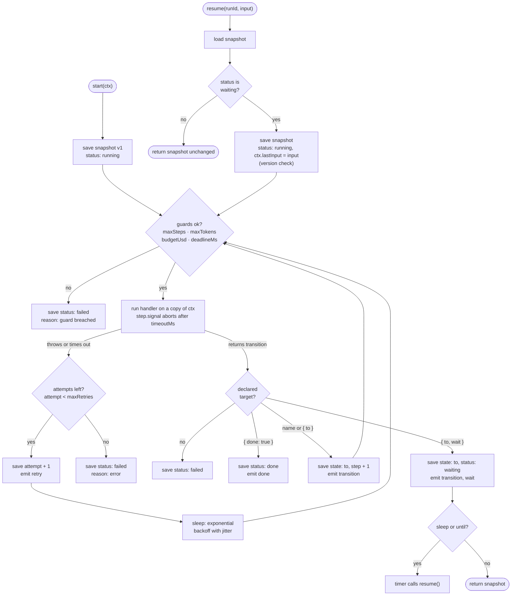

# Architecture

agenttsm is a step loop over a store. The loop is in
[`packages/core/src/machine.ts`](../packages/core/src/machine.ts); everything else is a port
(`Store`, `LLM`) or a convenience around it (`http()`, `test()`, `toMermaid()`, `route()`).

## Runtime loop



Every box that says "save" is one `store.save(snapshot, events)` call. Listeners registered with
`on()` run after that call succeeds, so an event is never delivered for a step that wasn't
persisted.

## Invariants

- **A snapshot is saved after every step, before the next handler runs.** `commit()` is awaited in
  `drive()` before the loop continues.
- **A failed attempt leaves ctx untouched.** Each attempt runs on `structuredClone(snapshot.ctx)`;
  only a successful attempt's copy is committed.
- **The attempt count is part of the snapshot.** A retry commits `attempt + 1` before sleeping, so a
  crash during backoff resumes with the right count.
- **A paused handler never re-runs.** A wait transition saves the next state as `state`, and
  `resume()` starts the loop there.
- **Unknown targets fail early.** `validate()` runs in `defineMachine()`, and the `const S` type
  parameter makes them compile errors too.
- **Concurrent resumes do not both proceed.** Every save carries `version = previous + 1`, and the
  store rejects any other version with `AgentTsmError("conflict")`.
- **Usage is metered.** `step.llm` wraps the configured LLM, passes `step.signal`, and adds `tokens`
  and `costUsd` to the snapshot's `usage`.

## Store port

```ts
interface Store {
  save(snapshot: Snapshot, events: readonly RunEvent[]): Promise<void>;
  load(runId: string): Promise<Snapshot | undefined>;
  list(filter?: { status?: Status; state?: string }): Promise<Snapshot[]>;
  trace(runId: string): Promise<TraceEntry[]>;
}
```

`save` must be atomic: it writes the snapshot and its events together, or neither, and rejects
unless `snapshot.version` is exactly one more than the stored version (0 for a new run).
`MemoryStore` does this with a synchronous check-and-set. A Postgres store can do the same with one
transaction:

```sql
UPDATE runs SET snapshot = $2, version = $3 WHERE run_id = $1 AND version = $3 - 1;
-- 0 rows updated: throw AgentTsmError("conflict")
INSERT INTO run_trace (run_id, seq, entry) VALUES ...;
```

`trace(runId)` returns events and snapshots in the order they were saved: a step's events come
before the snapshot they produced.

## Timed waits across restarts

`sleep` and `until` waits are resumed by an in-process timer. After a restart those timers are
gone; a durable deployment finds the due runs with `store.list({ status: "waiting" })` and calls
`resume()` for each. The version check makes it safe for a timer and a worker to race.

## What core does not do

- No LLM SDK, HTTP framework or database driver. They are adapters in user code or the examples.
- No nested or parallel states. A machine is a flat set of states; compose machines by starting
  one from another state's handler.
- No cancellation of handler work on timeout beyond aborting `step.signal`. Handlers should pass
  the signal to I/O.

## Ports to other languages

The [conformance scenarios](../conformance/README.md) describe each runtime rule as data. A port
implements the same loop and passes the same files.
