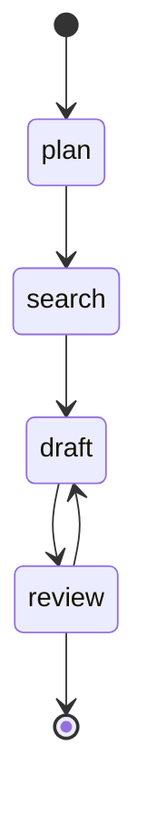

# 05 · Research pipeline

`plan → search → draft → review`, where `review` either finishes or sends the draft back. LLM
usage is metered against a budget guard, and the machine's diagram is written to
[`graph.md`](graph.md).

```sh
pnpm --filter 05-research-pipeline start
```

```text
wrote .../examples/05-research-pipeline/graph.md

plan -> search
search -> draft
draft -> review
review -> draft
draft -> review

done after 6 steps, 2000 tokens, $0.020
brief: Agent workflows need durable state, human checkpoints and budgets that stop runaway loops.
```



## What it shows

- `guards: { budgetUsd: 0.05, maxSteps: 12 }`. Every `step.llm.complete()` adds the response's
  `tokens` and `costUsd` to `snapshot.usage`, and the guard is checked before each step. Lower the
  budget to `0.01` to watch the run fail with `budgetUsd guard breached`.
- `final: true` lets `review` either finish or return to `draft`.
- `machine.toMermaid()` draws the declared transitions; the script writes them to `graph.md`.
- Tools passed to `defineMachine({ tools })` appear on `step.tools` with their own types.

## Real model

```sh
LLM=anthropic ANTHROPIC_API_KEY=... pnpm --filter 05-research-pipeline start
```

The adapter reports real token counts and prices them at Claude Opus 5.5 rates, so the budget
guard applies to real spend.
